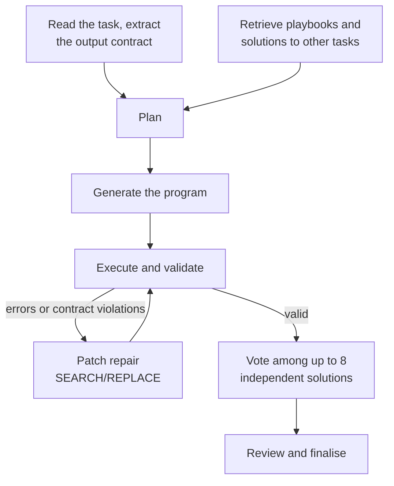
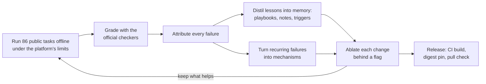

# Quant-Finance Coding Agent

**English** | [中文](README.zh-CN.md)

An autonomous LLM agent that reads quantitative-finance programming tasks, then writes, runs and repairs
Python until its deliverables pass hidden tests. Built for **NeurIPS 2026 Agenthon, Track 1 (Coding)**, where
it finished **tied for first in the Final** with a pass@1 of 0.1786, the highest score on the board.

## Results

| Phase | Agent version | Result (pass@1) |
|---|---|---|
| **Final, hidden tasks** | **2.9.16** | **0.1786: tied for first** |
| Development, 86 public tasks | 2.9.3 | 0.3488 (30/86) |
| Development, 86 public tasks | 2.0 | 0.2674 (23/86) |


## The problem

Each task gives the agent a natural-language specification and its data (CSV, Parquet, JSON, Excel, XML/XBRL
filings). The agent has to produce the deliverables (JSON, CSV, Parquet, HTML) with exact file names, schemas
and numbers. A hidden pytest checker grades every task, with a median of 24 assertions per task, and a task
counts only if every assertion passes.

The tasks span derivatives pricing, market risk, fixed income and FX, credit, backtesting and factor research,
execution, and SEC filings and text. Every team works under the same constraints:

- **Model:** one shared open model (NVIDIA Nemotron 3 Super, 120B-A12B, FP8).
- **Budget:** at most 25 requests per task and 4,000 output tokens per request.
- **Sandbox:** non-root user, read-only root filesystem, 64 MiB `/tmp`, and no network except the model endpoint.
- **Time:** a per-task limit from the task card, plus 24 hours for the whole Final run.

## How the agent solves a task (inner loop)



1. **Read the task and extract the output contract.** The agent reads the specification, the task card (time
   limit) and previews of the data, and maps the paths named in the text to the real files. It then parses the
   deliverables: file names, JSON templates, CSV columns, row counts and sort orders.
2. **Retrieve reference material.** BM25 retrieval selects method playbooks and verified solutions to *other*
   public tasks. Matching by task ID and by a 5-gram Jaccard fingerprint ensures a task never sees its own
   solution, and notes whose keywords appear in the task are always included.
3. **Plan.** One call returns a JSON plan: the method and formulas, the deliverables, and which references to use.
4. **Generate the program.** The model writes a complete Python script. A program cut off at the 4,000-token cap
   is continued exactly where it stopped, or generated in two parts. "Debug this script" tasks start from the
   script the task ships.
5. **Execute and validate.** The script runs in the sandbox with a timeout. The outputs are checked for
   completeness, parseability, NaNs, the output contract, and identifiers that match the inputs.
6. **Repair.** Errors and contract violations go back to the model, which answers with SEARCH/REPLACE patches
   (up to 12 attempts). If a repair repeats an earlier script, sampling is loosened to break the loop.
7. **Vote.** Once an output is valid, the remaining budget buys up to 8 independent solutions (2 requested
   concurrently), and the answer is chosen by agreement on their key numbers.
8. **Review and finalise.** A review against the specification may propose a revised script, which is kept only
   if it is not worse. The best outputs so far are restored, canary GUIDs are scrubbed, and missing deliverables
   get placeholders: the agent never crashes and never finishes empty.

Every task runs within a soft budget of about 8 minutes, scaled up for tasks with longer limits. A hard stop
follows two minutes later and never comes closer than 45 seconds to the task's own limit. The model client
counts requests correctly under concurrency and retries transient errors, proxy refusals (HTTP 407) and rate
limits (HTTP 429) without wasting the request budget.

## How the agent was developed (outer loop)



1. **A faithful offline environment.** The shared FP8 model is served with vLLM on 2× NVIDIA H200, and
   `eval/local_eval.sh` runs every public task under the platform's container limits: non-root user, read-only
   root, 64 MiB `/tmp`, 256 processes, 16 CPUs, and no network except the model. Each task is graded with its
   official checker. Local results matched the official board (24/86 locally, 23/86 on the Development
   leaderboard), so offline numbers could be trusted.
2. **Failure attribution.** Every failing task is classified. In the 2.0 analysis, the 62 failures broke down as:
   - numerical conventions such as annualisation, ddof and calendars: 16
   - truncated programs: 13
   - violated invariants: 13
   - checker-specific details: 8
   - the same crash repeated: 6
   - structure or format errors: 4
   - empty outputs accepted too early: 2
3. **Distilling experience into memory.** General lessons became method playbooks, notes and keyword-triggered
   rules in the retrieval memory, which grew from 49 to 78 documents. Same-task exclusion keeps every lesson
   usable only for *other* tasks.
4. **Turning recurring failures into mechanisms.**
   - truncation: exact continuation and two-part generation
   - repeated crashes: patch repairs and loop breaking
   - wrong numbers: independent-solution voting
   - mismatched identifiers: key checks
   - "debug this script" tasks: editing the shipped script
5. **Ablation.** Every change sits behind an environment flag (`AGENT_*`) and is A/B-tested on the full task set.
   Only changes that help are kept. More than a dozen rounds took the agent from 2.0 to 2.9.16, and the
   Development score from 23/86 to 30/86.
6. **Release.** GitHub Actions builds the `linux/amd64` image, pins it by digest, checks anonymous pulls, runs an
   offline conformance sweep over all public tasks, and packages the signed submission. More than 200 unit tests
   and a mock model server guard every release.

## Repository layout

| Path | What it is |
|---|---|
| `agent/agent.py` | the agent: task loading, model client, solver loop, voting, finalisation |
| `agent/memory.py`, `agent/memory/` | memory library and its retrieval (solutions, playbooks, notes, fingerprints) |
| `agent/selfcheck.py` | output-contract parsing and checks |
| `Dockerfile`, `Dockerfile.lite` | the competition image, and a variant without the memory library |
| `eval/` | offline evaluation with a self-hosted model (vLLM) and the official checkers |
| `tests/` | unit tests and a mock model server for end-to-end runs |
| `scripts/` | image build, anonymous-pull check, submission descriptor and packaging helpers |
| `.github/workflows/` | CI: image build and push, pull check, evaluation self-test |

## Quick start

```bash
# 1. Build the organizers' base image, then the agent image
git clone https://github.com/Agenthon-2026/track1-coding-public kit
docker build --platform linux/amd64 -t finance-bench-sandbox:latest -f kit/docker/sandbox.Dockerfile kit
docker build --platform linux/amd64 -t quant-coding-agent .

# 2. Solve one task with any OpenAI-compatible endpoint that serves the model
mkdir -p out && cp -r kit/units/t1-asian-option-levy-curran task && rm -rf task/checks
docker run --rm --network host --read-only --tmpfs /tmp:rw,size=64m \
  -e MODEL_ENDPOINT=http://127.0.0.1:8000 -e MODEL_NAME=house \
  -v "$PWD/task:/input:ro" -v "$PWD/out:/app/output" \
  quant-coding-agent solve --task-dir /input --out /app/output

# 3. Unit tests
python -m pytest tests/
```

To evaluate all 86 public tasks against the official checkers with a self-hosted model, see `eval/README.md`.
Serving the FP8 model takes 2× H100/H200-class GPUs.

## Notes

- `agent/memory/solutions/` contains reference solutions to the public QF-Bench Track 1 tasks. The agent uses
  them only as in-context examples for *other* tasks. Please don't use this repository as training data for
  models that will be evaluated on QF-Bench.
- Competition rules and the task kit: https://www.agenthon.net/ and
  https://github.com/Agenthon-2026/track1-coding-public

## License

Apache License 2.0; see `LICENSE`.
