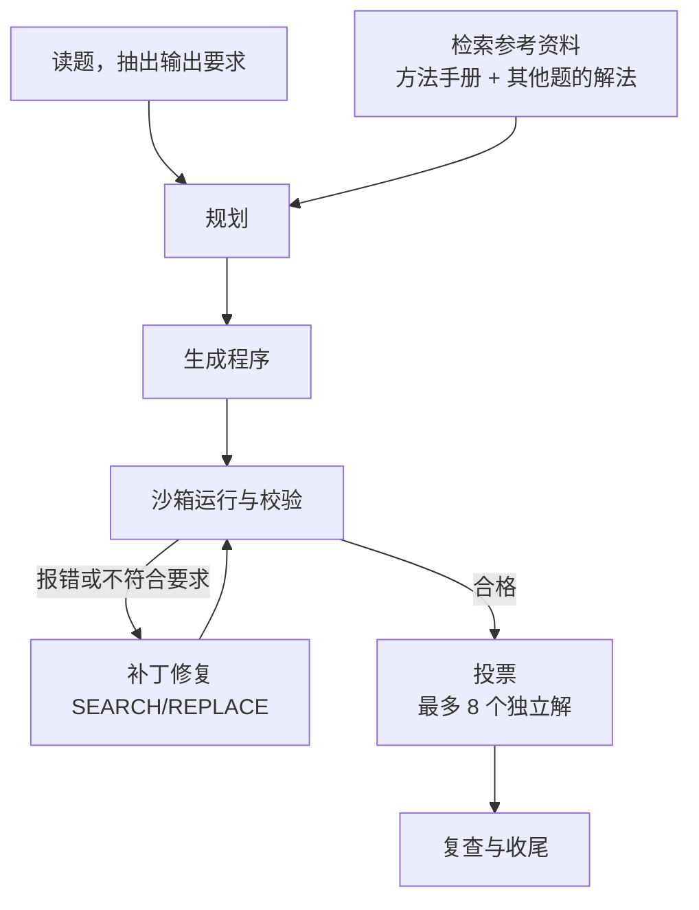
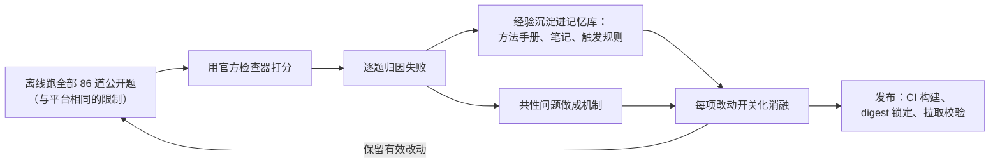

# 量化金融编程智能体（Quant-Finance Coding Agent）

[English](README.md) | **中文**

一个自主的 LLM Agent：读取量化金融编程任务，自动编写、运行并修复 Python 程序，直到结果通过隐藏测试。
为 **NeurIPS 2026 Agenthon 竞赛 Track 1（Coding）** 开发，在 **Final 中并列第一**（pass@1 0.1786，榜单最高分）。

## 成绩

| 阶段 | Agent 版本 | 成绩（pass@1） |
|---|---|---|
| **Final（隐藏题）** | **2.9.16** | **0.1786，并列第一** |
| Development（86 道公开题） | 2.9.3 | 0.3488（30/86） |
| Development（86 道公开题） | 2.0 | 0.2674（23/86） |

## 任务是什么

每道题给出自然语言的任务说明和数据（CSV、Parquet、JSON、Excel、XML/XBRL 财报文件）。Agent 要交出结果文件
（JSON、CSV、Parquet、HTML），文件名、字段结构和数值都必须准确。每道题由隐藏的 pytest 检查器打分，中位数
24 条断言，全部通过才算这道题做对。

题目覆盖衍生品定价、市场风险、固收与外汇、信用风险、策略回测与因子研究、交易执行，以及 SEC 财报和文本解析。
所有队伍的约束相同：

- **模型**：统一的开源模型（NVIDIA Nemotron 3 Super，120B-A12B，FP8）。
- **预算**：每题最多 25 次调用，每次最多输出 4,000 tokens。
- **沙箱**：非 root 用户、根文件系统只读、`/tmp` 只有 64 MiB、除模型接口外没有网络。
- **时间**：每题有题目卡片规定的时限，整轮 Final 共 24 小时。

## 解一道题的过程（内循环）



1. **读题，抽出输出要求。** 读取任务说明、题目卡片（时限）和数据预览，把题面里写的路径对应到真实文件；
   再解析要交什么：文件名、JSON 字段模板、CSV 列、行数和排序。
2. **检索参考资料。** 用 BM25 检索方法手册和*其他*公开题的已验证解法。按题号和 5-gram Jaccard 指纹匹配，
   保证一道题永远看不到自己的解法；题面出现特定关键词时，对应的笔记一定带上。
3. **规划。** 一次调用让模型返回 JSON 计划：用什么方法和公式、交哪些文件、参考哪几份资料。
4. **生成程序。** 模型写出完整的 Python 脚本。被 4,000 token 上限截断时，从断点精确续写，或拆成两段生成；
   "修复给定脚本"类题直接从题目提供的脚本改起。
5. **运行与校验。** 在沙箱里带超时运行，检查输出是否齐全、能否解析、有没有 NaN、是否符合输出要求、
   标识列是否和输入一致。
6. **修复。** 把报错和不符合要求的地方反馈给模型，模型用 SEARCH/REPLACE 补丁修改，最多 12 次；
   如果改出来的脚本和之前重复，就提高随机性跳出循环。
7. **投票。** 得到合格结果后，用剩余预算再生成最多 8 个独立解（每次并发 2 个），按关键数值的一致性选出答案。
8. **复查与收尾。** 让模型对照任务说明复查，给出的修订版不比原来差才采用。最后恢复最好的一版输出、
   清除 canary GUID、缺失的文件写占位：Agent 不会崩溃，也不会交白卷。

每题的软预算约 8 分钟（时限更长的题按比例放宽），之后两分钟强制停止，且最晚在题目时限前 45 秒停止。
模型客户端在并发下准确计数，网络错误、代理拒绝（HTTP 407）和限流（HTTP 429）都会重试，且不浪费调用次数。

## Agent 是怎么迭代出来的（外循环）



1. **可信的离线评测环境。** 在 2× NVIDIA H200 上用 vLLM 部署同款 FP8 模型，`eval/local_eval.sh` 按平台的
   容器限制运行每道公开题（非 root、根目录只读、64 MiB `/tmp`、256 个进程、16 核 CPU、除模型外无网络），
   并用该题的官方检查器打分。本地结果和官方榜单一致（本地 24/86，Development 榜 23/86），离线数字可信。
2. **失败归因。** 每道失败的题都归类。以 2.0 版本为例，62 道失败题分布如下：
   - 数值约定错误（年化因子、ddof、日历等）：16
   - 程序被截断：13
   - 违反金融不变量：13
   - 检查器特有的细节：8
   - 同一个错误反复出现：6
   - 结构或格式错误：4
   - 空结果被过早接受：2
3. **经验沉淀进记忆库。** 通用教训写成方法手册、笔记和关键词触发规则，记忆库从 49 份增长到 78 份。
   同题排除保证每条经验只用于*其他*题。
4. **共性问题做成机制。**
   - 截断：断点续写、分两段生成
   - 反复报错：补丁修复、跳出循环
   - 数值错误：多个独立解投票
   - 标识列对不上：键一致性检查
   - "修复给定脚本"类题：直接修改题目提供的脚本
5. **消融筛选。** 每项改动都做成环境变量开关（`AGENT_*`），在全部题目上做 A/B 对比，只保留有效的。
   经过十余轮迭代，Agent 从 2.0 演进到 2.9.16，Development 成绩从 23/86 提升到 30/86。
6. **发布。** GitHub Actions 构建 `linux/amd64` 镜像、按 digest 锁定、检查匿名拉取、对全部公开题做离线
   一致性检查，并打包签名后的提交文件。200 多个单元测试和一个模拟模型服务保障每次发布。

## 目录结构

| 路径 | 内容 |
|---|---|
| `agent/agent.py` | Agent 主体：读题、模型客户端、求解循环、投票、收尾 |
| `agent/memory.py`、`agent/memory/` | 记忆库及检索（解法、方法手册、笔记、指纹） |
| `agent/selfcheck.py` | 输出要求的解析与检查 |
| `Dockerfile`、`Dockerfile.lite` | 比赛镜像，以及不含记忆库的精简版 |
| `eval/` | 用自建模型服务（vLLM）和官方检查器做离线评测 |
| `tests/` | 单元测试，以及用于端到端测试的模拟模型服务 |
| `scripts/` | 镜像构建、匿名拉取检查、提交描述文件与打包工具 |
| `.github/workflows/` | CI：镜像构建与推送、拉取检查、评测自检 |

## 快速上手

```bash
# 1. 先构建主办方的基础镜像，再构建 Agent 镜像
git clone https://github.com/Agenthon-2026/track1-coding-public kit
docker build --platform linux/amd64 -t finance-bench-sandbox:latest -f kit/docker/sandbox.Dockerfile kit
docker build --platform linux/amd64 -t quant-coding-agent .

# 2. 用任意兼容 OpenAI 接口、部署了该模型的服务解一道题
mkdir -p out && cp -r kit/units/t1-asian-option-levy-curran task && rm -rf task/checks
docker run --rm --network host --read-only --tmpfs /tmp:rw,size=64m \
  -e MODEL_ENDPOINT=http://127.0.0.1:8000 -e MODEL_NAME=house \
  -v "$PWD/task:/input:ro" -v "$PWD/out:/app/output" \
  quant-coding-agent solve --task-dir /input --out /app/output

# 3. 单元测试
python -m pytest tests/
```

用自建模型和官方检查器评测全部 86 道公开题，见 `eval/README.md`。部署 FP8 模型需要 2 张 H100/H200 级别的 GPU。

## 说明

- `agent/memory/solutions/` 里有 QF-Bench Track 1 公开题的参考解法，Agent 只把它们当作解*其他*题时的示例。
  请不要把本仓库用作将在 QF-Bench 上评测的模型的训练数据。
- 比赛规则与题目：https://www.agenthon.net/ 和 https://github.com/Agenthon-2026/track1-coding-public

## 许可证

Apache License 2.0，见 `LICENSE`。
