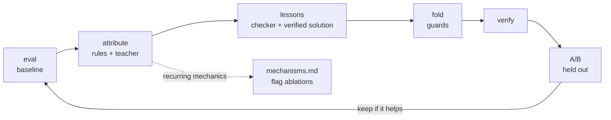

# devloop: the outer loop as code

The agent was developed in rounds. Each round evaluated it offline on the 86 public tasks, attributed every failure,
turned the general lessons into memory and A/B-tested every change, keeping only what helped (see "How the agent was
developed" in the [README](../README.md)). During the competition, the attribution, the lessons and the folding were
done semi-manually by an LLM assistant following the guides in [`guides/`](guides/). `devloop` was written after the
competition to run the same procedure end to end as code.



## One round

1. **eval**: the agent solves the public tasks under the platform's limits (`eval/local_eval.sh`), with an explicit
   copy of the memory library mounted and `AGENT_PB_EXCLUDE=1`.
2. **attribute**: rules over the agent and checker logs classify each failure (truncation, empty output accepted,
   repeated crash, structure, checker-specific, invariants, conventions, infra). The teacher then confirms or refines
   the label and writes a root cause and a lesson for *other* tasks. Failure classes that recur go to
   `mechanisms.md`, with the agent switches that are still off in the image and the command that A/B-tests them.
3. **lessons**: for the failures that knowledge can fix, the teacher writes a lesson card. It sees what the agent
   could not see: the task's checker and a verified reference solution. When the library has no solution for a task,
   one is written first, with the checker in the loop.
4. **fold**: the general part of the lessons is folded into the playbooks. Every proposed file passes the guards
   below and gets one revision round if it fails. Accepted files form a candidate library.
5. **verify**: the candidate library loads, keeps its format, loses nothing, and every new solution passes its
   checker.
6. **A/B**: the candidate is evaluated exactly like the baseline and kept only if it gains at least `--min-gain`
   units (default 2, about the run-to-run noise). With `--apply` the changed files are copied into `agent/memory/`
   for review with `git diff`.

The next round starts from the kept candidate. The loop stops at the first round that keeps nothing.

## What keeps it honest

- **Held out by construction.** Each new or edited document records the tasks it was derived from in
  `pb_exclude.json`. Both arms run with `AGENT_PB_EXCLUDE=1`, so a task never sees a document made from its own
  lesson, and a gain has to come from other tasks. The report also gives the change on the tasks the edit was not
  derived from.
- **No leakage into the library.** New content may not name a public task, use its file names, or repeat a number
  from its checker or task text (three or more significant digits, common constants excepted). It may never carry a
  GUID or a canary line. Pinned notes, which reach every task, are off limits.
- **Format and execution.** Front matter and the four playbook sections, at most 140 lines, snippets of at most 45
  lines, and every new snippet must run.
- **Solutions compute.** A teacher-written solution may not read `checks/` or paste the checker's numbers.
- **Noise-aware decisions.** Repeats per arm, a minimum gain, and an exact sign test (McNemar's test for single runs).
- **No silent changes.** Nothing reaches `agent/memory/` without `--apply`. Agent code is never edited.

## Quick start

devloop needs Python 3.10+ and nothing outside the standard library. It imports `agent/memory.py` and
`agent/selfcheck.py`.

```bash
git clone https://github.com/Agenthon-2026/track1-coding-public kit
docker build -t finance-bench-sandbox:latest -f kit/docker/sandbox.Dockerfile kit
docker build -t agenthon-t1-agent:dev .
bash eval/serve_vllm.sh &               # the House model for the agent (see eval/README.md)

# The teacher can be any OpenAI-compatible endpoint. The House server works; a stronger model writes better lessons.
export DEVLOOP_ENDPOINT=http://127.0.0.1:8000 DEVLOOP_MODEL=house

python -m devloop round --kit kit --image agenthon-t1-agent:dev --repeats 2      # one round on all 86 tasks
cat devloop-work/rounds/01/report.md
```

Without a teacher, a round stops after the rule-based attribution, which is useful on its own.

| command | does | writes |
|---|---|---|
| `eval` | one evaluation, `--repeats` times | `runs/<label>/r<k>/` (results.csv, logs, outputs, run.json) |
| `attribute RUN...` | classify the failures | `attribution.md`, `attribution.jsonl`, `mechanisms.md` |
| `lessons ATTRIBUTION --runs RUN...` | lesson cards (and missing solutions) | `<out>/t1-*.md`, `<out>/solutions/` |
| `fold LESSONS --out DIR` | fold the lessons into a candidate library | `DIR/`, `DIR.proposals.json`, `DIR.fold/` |
| `verify [MEMORY]` | check a library; `--solutions` re-runs every solution against its checker | exit code 0/1 |
| `compare A... --vs B...` | A/B two groups of runs | Markdown on stdout |
| `ablate --variant AGENT_X=1` | A/B agent switches on the same library | `ablations/<label>/` |
| `round` | the whole loop, `--rounds N`, `--apply` | `rounds/<n>/`, `summary.md` |

Runners: `--runner docker` (default) uses `eval/local_eval.sh` and runs scripts in the agent image with
`--network none`. `--runner host` follows the same contract without containers, for throwaway root sandboxes and CI
machines without Docker. It re-points `/app`, `/input`, `/output` and `/tests` for every task, the same way as
`tests/solve_unit.sh`.

## A round's work directory

```
devloop-work/rounds/01/
  base-memory/        the library the round started from
  baseline/r1/        evaluation runs (results.csv, logs/, out/, run.json)
  attribution.md      failures by class, per-unit evidence and root cause   (+ attribution.jsonl)
  mechanisms.md       recurring mechanics, switches that are off, ablation commands
  lessons/            lesson cards (may quote the checker: working material, never shipped)
  fold/               the teacher's raw answers
  proposals.json      accepted and rejected files, with the guard findings
  memory/             the candidate library
  verify.json
  candidate/r1/       the candidate's evaluation runs
  compare.md          the A/B table and the decision
  report.md           everything above on one page
```

## Tests

`python -m pytest tests/test_devloop.py` runs offline with a deterministic teacher (`tests/mock_teacher.py`). As root
and with a kit, `DEVLOOP_E2E_KIT=<kit> python -m pytest tests/test_devloop.py -k e2e` also runs a real round on five
tasks with the host runner, the mock House server and the mock teacher over HTTP (about 80 seconds). One of the mock
House's answers uses a wrong coupon convention, so the round meets a knowledge failure next to a mechanics failure.

## Files

| file | content |
|---|---|
| `loop.py` | rounds, the stopping rule, flag ablations |
| `runner.py` | evaluations, solution and snippet runs, the docker and host runners |
| `runs.py` | the run layout, pass rates, repeats |
| `attribution.py` | log parsers, the failure classes and rules, the teacher refinement, the reports |
| `lessons.py` | lesson cards; checker-in-the-loop solutions for tasks without one |
| `fold.py` | grouping lessons by playbook, the fold requests, the candidate library, applying it |
| `guards.py` | format, hygiene, leakage, snippet and solution checks |
| `verify.py` | library checks; solution re-runs and self-check calibration |
| `compare.py` | pass rates, the sign test, the keep/discard decision |
| `llm.py` | the teacher client (OpenAI-compatible, retries) and answer parsers |
| `prompts/` | the teacher prompts (attribute, lesson, solve, fold) |
| `guides/` | the guides followed during the competition |
